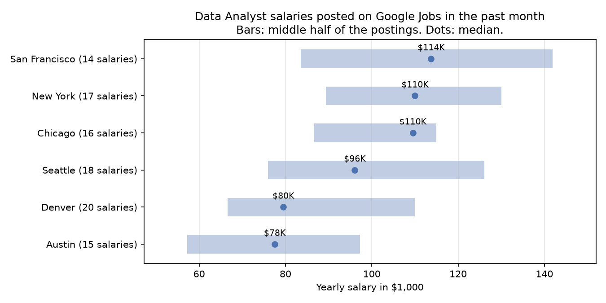

# Google Jobs API for Python

Get job listings from **Google Jobs** into Python: title, company, location, salary as numbers, posting date, job type, the full description and **direct apply links** (LinkedIn, Indeed, company career sites). Google Jobs collects postings from hundreds of job boards, so one search covers a large part of the market.

Google doesn't offer an API for Google Jobs results. These examples use a hosted scraper instead, the [Google Jobs Scraper](https://apify.com/ralfij/google-jobs-scraper) on Apify, through the official Python client.



*Example output: data analyst salaries in six US cities, from postings on Google Jobs in September and October 2026 (14 to 20 posted salaries per city, so treat it as a rough picture). Made with `examples/salary_report.py`.*

## Quick start

1. Create a free [Apify account](https://console.apify.com/sign-up). The free plan includes $5 of credit every month, which covers more than 1,000 jobs. No credit card needed.
2. Copy your API token from **Settings > API & Integrations** in Apify Console.
3. Run an example:

```bash
pip install -r requirements.txt
export APIFY_TOKEN=your-token        # Windows: set APIFY_TOKEN=your-token
python examples/search_jobs.py
```

```
Data Analyst - Business Intelligence           DRW                        100K–130K a year
Program Analyst (Data Analytics) - Federal Ac  GSA                        108,173–172,980 a year
Early Careers - Enterprise Data Analyst Inter  Health Care Service Corpo  19.13–34.17 an hour
Data Analyst, Marketing Hybrid                 Rewards Network Establish  80K–95K a year
...
40 jobs found
Saved jobs.csv
```

## Examples

| File | What it does |
|---|---|
| [`examples/search_jobs.py`](examples/search_jobs.py) | One search, printed as a table and saved as CSV with salaries and apply links |
| [`examples/salary_report.py`](examples/salary_report.py) | Salaries for one role in several cities, with the chart above |
| [`examples/new_jobs_alert.py`](examples/new_jobs_alert.py) | Only the jobs you haven't seen yet, optionally posted to Slack. Run it every morning. |

[`sample-output/data-analyst-chicago-2026-10.csv`](sample-output/data-analyst-chicago-2026-10.csv) shows the CSV from `search_jobs.py`.

## What you get per job

- `title`, `companyName`, `location`, `via` (the site Google found the posting on)
- `postedAt` ("3 days ago") and `postedDate` (2026-10-07)
- `scheduleType`, such as "Full-time", "Part-time", "Contractor" or "Full-time and Part-time"
- `salary` as Google shows it ("65K–70K a year"), plus `salaryMin`, `salaryMax`, `salaryCurrency` and `salaryPeriod` as separate values
- `applyOptions`: every place to apply, with direct URLs instead of Google redirects
- `description` and `highlights` (qualifications, benefits, responsibilities)
- `tags` such as "Health insurance" or "No Degree Mentioned"
- `jobId`, to recognize the same job in later runs

## Why Google Jobs is tricky to scrape

- **Google Search mostly needs JavaScript now.** Plain HTTP requests get a captcha or an "enable JavaScript" page, so you need a way around that first.
- **One search shows about 10 jobs, with no next page.** The scraper widens each search with recent date windows and common refinements (remote, full time, senior, entry level and so on), then removes duplicates. That's how one search can return 50 or more jobs.
- **Apply links are Google redirects.** The scraper follows them to the real job pages.
- **Salaries are text in many formats,** such as "65K–70K a year" or "€4.274,92 a month". The scraper turns them into numbers, a currency and a period.

## Other options

- **SerpApi** has a Google Jobs endpoint, with a monthly subscription.
- **Job board APIs** such as Adzuna's give you their own listings rather than Google's, some with a free tier.

## Use it from AI assistants (MCP)

To let Claude, Cursor, VS Code or another MCP client search Google Jobs for you, add this MCP server URL: `https://mcp.apify.com/?tools=ralfij/google-jobs-scraper`. Sign in to Apify when the client asks, or send your Apify API token as `Authorization: Bearer <token>`. Runs are billed to your own Apify account.

## Notes

- I built the Google Jobs Scraper used in these examples, so keep that in mind.
- Pricing is per job with no subscription; see the [actor page](https://apify.com/ralfij/google-jobs-scraper). There are ready-made searches on its [example tasks](https://apify.com/ralfij/google-jobs-scraper/examples/registered-nurse-jobs-texas), such as nurse jobs in Texas.
- Google Jobs isn't available in every country. The Netherlands, for example, returns no results. For local jobs elsewhere, write the search in the local language and set the `country` input, for example `pflegefachkraft berlin` with `de`.
- Recruiter e-mail addresses and phone numbers are removed from descriptions by default.
- Not affiliated with, endorsed by or sponsored by Google. Google Jobs is a trademark of Google LLC.

## License

MIT
